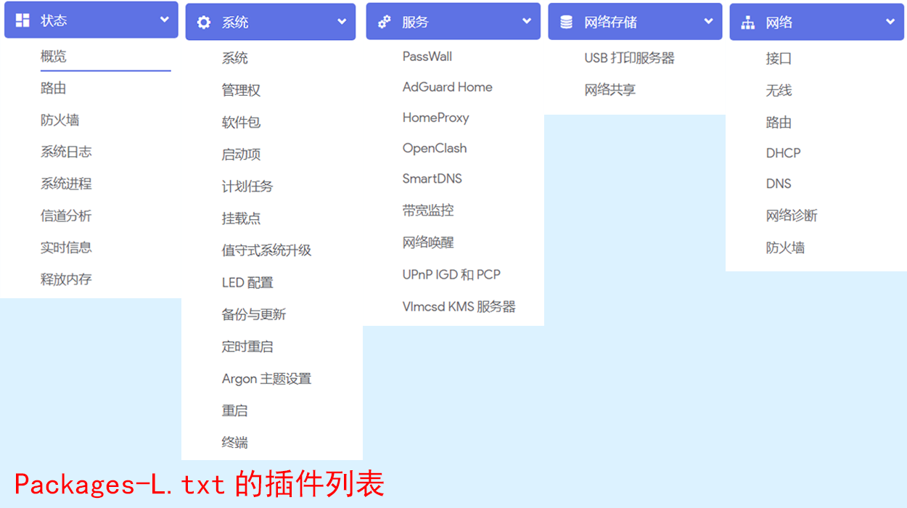
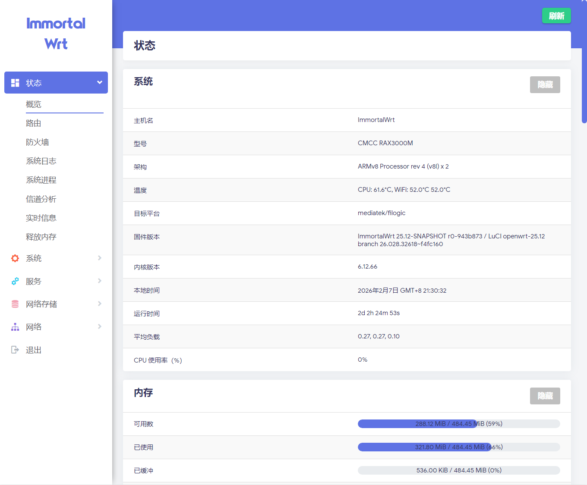
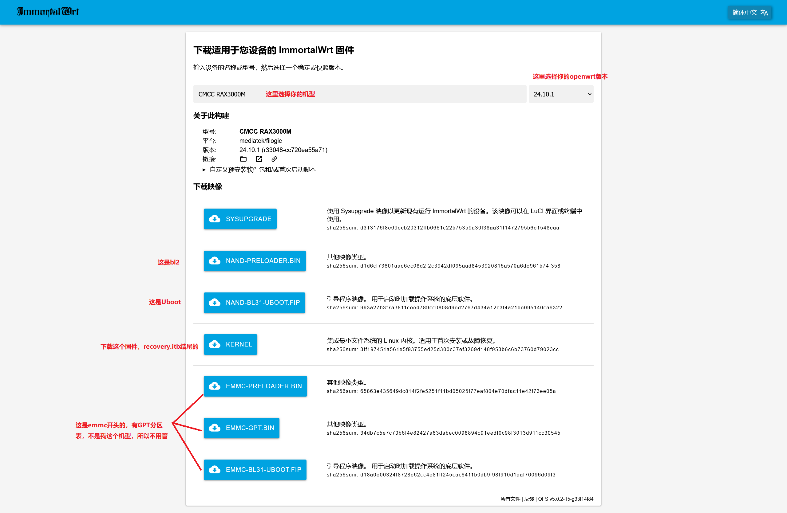

## License

[MIT](https://github.com/P3TERX/Actions-OpenWrt/blob/main/LICENSE) © [**P3TERX**](https://p3terx.com)   
[**作者源仓库 Actions-OpenWrt**](https://github.com/P3TERX/Actions-OpenWrt)

## 需遵循以下条款后方可使用，谢谢配合：
+ 合法使用：请遵循您所在国家和地区的法律法规。
+ 禁止非法活动：仅供科研、教育使用，不得用于任何非法用途，如网络攻击或传播恶意软件。
+ 维护国家利益：禁止从事任何有损国家利益的活动。
+ 免责声明：项目维护者不对因使用本项目导致的任何损失负责，用户需自行承担风险。

## 📢ip地址：192.168.8.1 
## 编译计划

| 北京时间 | 平台 | workflow | 源码分支 | 编译方式 |
| --- | --- | --- | --- | --- |
| 周一 04:00 | Allwinner | `allwinner.yml` | openwrt-25.12 | single |
| 周二 04:00 | ramips MT7621 | `mt7621.yml` | openwrt-25.12 | single |
| 周三 04:00 | Rockchip | `rockchip.yml` | openwrt-25.12 | single |
| 周四 04:00 | MTK Filogic | `mtk_filogic.yml` | openwrt-25.12 | single |
| 周五 04:00 | X86-64 | `X86-64.yml` | openwrt-25.12 | single |
| 周日 06:00 | — | `Auto-Clean.yml`（清理 Release/流水线记录） | — | — |

`master-X86-64.yml`、`master-rockchip.yml`、`master-mtk_filogic.yml` 只能手动触发，
走 `staged` 分步编译（工具链/内核/插件/固件分开编，中间清磁盘），更省空间、总时长更长。

---

## 目录结构

| 文件夹 | 用途 |
| --- | --- |
| `.github/workflows/build.yml` | **唯一一份编译流程**（reusable workflow），所有平台都调它 |
| `.github/workflows/*.yml`（其余） | 各平台的"开关"，只有 20 行，负责定时/手动触发并传参 |
| `configs/Target-*.txt` | 设备/平台配置（选哪些型号出固件） |
| `configs/Packages*.txt` | 插件配置（`Packages.txt` 全量 / `Packages-L.txt` 精简 / `Packages-5G.txt` 5G） |
| `files/etc` | 随固件下发的内置配置（目前是 smartdns） |
| `patches/rust` | 覆盖 feeds 里的 rust 包（1.98.1 + 本地补丁） |
| `scripts/` | 各个构建阶段的脚本，全部约定"在 openwrt 源码根目录执行" |
| `doc/` | README 用的截图 |

---

smartdns（海外端口6553） Openclash已下载好clash?内核 

 
 

## 如何使用呢？ 

**X86** 平台：应该不用教了吧，写在U盘也行，硬盘也行。 

**Allwinner、Rockchip** 平台：能插内存卡的可以写内存卡，emmc的就自己找官方工具写入 

**mt7621** 应该也不难，先刷好不死然后刷 -factory.bin 后面再刷 -squashfs-sysupgrade.bin 就可以 

**MTK-filogic** 平台最麻烦 
先科普一下（*建议参考其他教程刷！需要按顺序刷入！*） 
**-gpt.bin** 有些存储空间比较大的机型会有这个文件，不多（*有的话第一次也要刷* ） 
**-preloader.bin** 是 **bl2** （op官方需要..所以第一次刷必须！） 
**-bl31-uboot.fip** 是 **uboot** （不刷你也刷不了这个固件！）*后续想刷回lede的固件可以用ttl先把这个刷了，Uboot就改它需要的文件名..就是 -fip.bin 文件改 -bl31-uboot.fip文件..* 
**-recovery.itb** 这是uboot自动识别刷入的 第一个初始固件（这里推荐使用天灵大佬的初始固件，下面网址），刷了以后开机进去的时候会提示让你刷 -squashfs-sysupgrade.itb 结尾的固件（这个就可以刷本仓库编译出来带 squashfs 的固件） 

[ImortalWrt Firmware Selector](https://firmware-selector.immortalwrt.org/)
这是天灵大佬的自动生成固件网站 

例如我的设备CMCC RAX3000M nand版本

如果你本来是有192.168.1.1后台的uboot了（能刷lede固件的）如何切换到这个固件呢？ 
192.168.1.1/bl2.html 
192.168.1.1/uboot.html 
根据上面提示自己领悟..完毕。 
 
**English** | [中文](https://p3terx.com/archives/build-openwrt-with-github-actions.html)

# Actions-OpenWrt

A template for building OpenWrt with GitHub Actions

## Credits

- [Microsoft Azure](https://azure.microsoft.com)
- [GitHub Actions](https://github.com/features/actions)
- [OpenWrt](https://github.com/openwrt/openwrt)
- [Lean's OpenWrt](https://github.com/coolsnowwolf/lede)
- [tmate](https://github.com/tmate-io/tmate)
- [mxschmitt/action-tmate](https://github.com/mxschmitt/action-tmate)
- [csexton/debugger-action](https://github.com/csexton/debugger-action)
- [Cowtransfer](https://cowtransfer.com)
- [WeTransfer](https://wetransfer.com/)
- [Mikubill/transfer](https://github.com/Mikubill/transfer)
- [actions/upload-artifact](https://github.com/actions/upload-artifact)
- [softprops/action-gh-release](https://github.com/softprops/action-gh-release)
- [Mattraks/delete-workflow-runs](https://github.com/Mattraks/delete-workflow-runs)
- [dev-drprasad/delete-older-releases](https://github.com/dev-drprasad/delete-older-releases)
- [peter-evans/repository-dispatch](https://github.com/peter-evans/repository-dispatch)

#### Related Repositories（部分代码灵感来源，感谢~）

- [VIKINGYFY/OpenWRT-CI](https://github.com/VIKINGYFY/OpenWRT-CI)
- [smallprogram/OpenWrtAction](https://github.com/smallprogram/OpenWrtAction)
- [zzcabc/OpenWrt_Action](https://github.com/zzcabc/OpenWrt_Action)
- [WYC-2020/Actions-OpenWrt](https://github.com/WYC-2020/Actions-OpenWrt)
- [mingxiaoyu/R1-Plus-LTS](https://github.com/mingxiaoyu/R1-Plus-LTS)
- [SuLingGG/OpenWrt-Rpi](https://github.com/SuLingGG/OpenWrt-Rpi)

